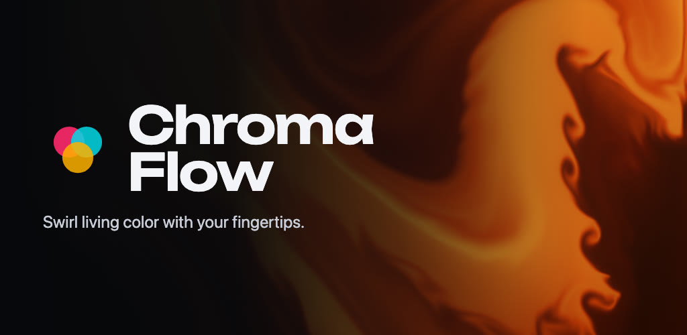
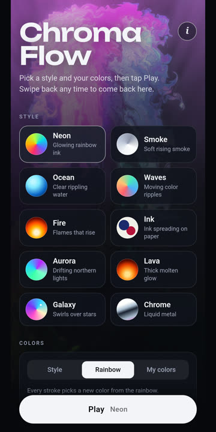

<p align="center"></p>

# Chroma Flow

[](https://github.com/Neerajreddyapi/ChromaFlow/actions/workflows/build.yml)
[](LICENSE)
[](CONTRIBUTING.md)

A fluid art app for Android. Touch the screen and swirl living color with your fingertips.

<p>
  
  
  
  
  
</p>

## Features

- **10 styles:** Neon, Smoke, Ocean, Waves, Fire, Ink, Aurora, Lava, Galaxy and Chrome, each with its own look (glow, heat, ripples, liquid metal, ink on paper, water with caustics).
- **Your colors:** use the style's palette, a rainbow, or pick four of your own plus the background.
- **Play mode:** a bare full-screen canvas with nothing on top. Mirror, 4-way and kaleidoscope symmetry, tilt your phone to pour, auto-stir, tap to splash.
- **Fine-tune each style:** brightness, color intensity, glow, swirl, how long color lasts, brush size and more. Each style remembers its own settings.
- **Private by design:** no internet permission, no permissions at all, no ads, no tracking.

## How it works

The whole app is a full-screen WebView over [`app/src/main/assets/index.html`](app/src/main/assets/index.html), which holds the WebGL fluid engine and the menu. [`MainActivity.java`](app/src/main/java/com/chromaflow/app/MainActivity.java) only handles full screen, the Back gesture (play → menu → exit), keep-screen-on while playing, and the system font size.

## Development setup

Want to change Chroma Flow or build it yourself? Here's how to set up your environment.

1. **Install [Android Studio](https://developer.android.com/studio).** It includes the Android SDK and a bundled JDK. In *SDK Manager*, make sure **Android SDK Platform 36** is installed (the app compiles against API 36 and runs on Android 8.0+).
2. **Clone the repo:**
   ```sh
   git clone https://github.com/Neerajreddyapi/ChromaFlow.git
   cd ChromaFlow
   ```
3. **Open it in Android Studio** (*File → Open* → the `ChromaFlow` folder) and let Gradle sync. Android Studio creates `local.properties` with your SDK path for you.
4. **Run it:** pick an emulator or a phone with USB debugging turned on, then press **Run ▶**. Or, from the terminal:
   ```sh
   # macOS: use Android Studio's bundled JDK
   export JAVA_HOME="/Applications/Android Studio.app/Contents/jbr/Contents/Home"
   ./gradlew installDebug
   ```
   If Chroma Flow from Google Play is already installed, uninstall it first. Android won't install a build signed with a different key over it.

**Where to make changes**

- **Visuals, styles, settings and menu:** [`app/src/main/assets/index.html`](app/src/main/assets/index.html). Styles live in the `STYLES` list, sliders in `SLIDERS`, and the fluid shaders are in the same file.
- **Android behaviour** (full screen, Back gesture, keep-screen-on, font size): [`MainActivity.java`](app/src/main/java/com/chromaflow/app/MainActivity.java).

**Quick preview without a phone:** open `app/src/main/assets/index.html` in desktop Chrome. Press **Enter** to play, drag with the mouse to paint, and press **Esc** to return to the menu. Check on a real phone before releasing, since touch and performance differ.

**Logs:** JavaScript `console` messages from the app go to logcat under the `ChromaFlow` tag:
```sh
adb logcat -s ChromaFlow
```

## Contributing

Contributions are welcome: bug reports, ideas, new styles, fixes and docs.

1. Read the **[contributing guide](CONTRIBUTING.md)**. It covers the workflow, the project principles, how to add a style, and the testing checklist.
2. For anything bigger than a small fix, [open an issue](https://github.com/Neerajreddyapi/ChromaFlow/issues/new/choose) first.
3. Fork, branch, make your change, test it on a phone, and open a pull request. CI builds every pull request automatically.

Please follow the [Code of Conduct](CODE_OF_CONDUCT.md). Report security problems privately, as described in [SECURITY.md](SECURITY.md). Release notes are in the [changelog](CHANGELOG.md).

## Build

Requirements: Android Studio (or JDK 17+) and the Android SDK. No third-party libraries.

```sh
./gradlew assembleRelease   # APK  -> app/build/outputs/apk/release/
./gradlew bundleRelease     # AAB  -> app/build/outputs/bundle/release/
```

Release signing reads `keystore.properties` from the repo root (not committed):

```properties
storeFile=your-upload-key.jks
storePassword=...
keyAlias=upload
keyPassword=...
```

Without that file, release builds are signed with the debug key so a fresh clone still builds and installs.

## Privacy

Chroma Flow collects nothing. Read the [privacy policy](https://neerajreddyapi.github.io/ChromaFlow/privacy-policy.html).

## Credits

- Credits to Chinni (Kothi 🐒).
- The fluid solver is adapted from [WebGL Fluid Simulation](https://github.com/PavelDoGreat/WebGL-Fluid-Simulation) by Pavel Dobryakov (MIT).
- Title font: [Unbounded](https://github.com/googlefonts/unbounded) (SIL Open Font License 1.1).

## License

[MIT](LICENSE) © 2026 Neeraj Reddy. Third-party notices are included in the license file.
